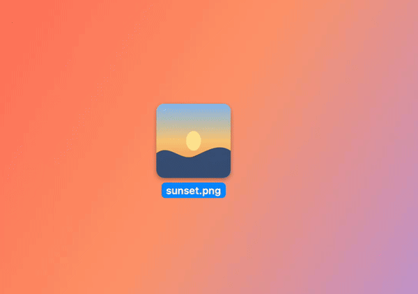
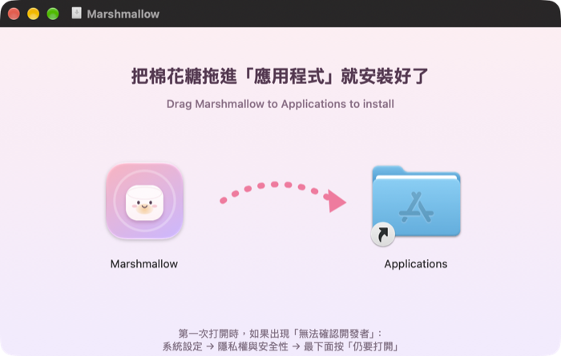
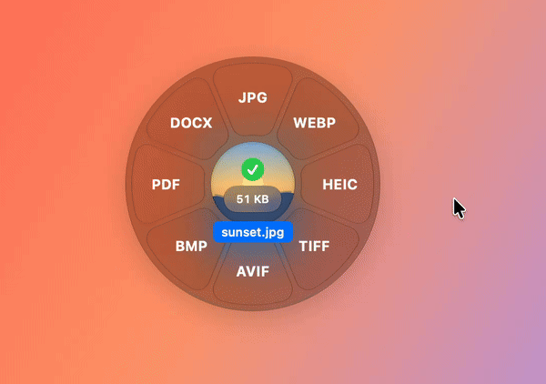
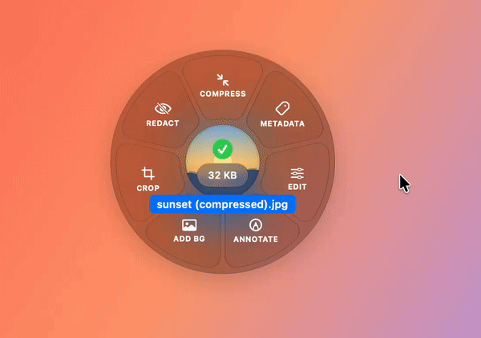

<p align="center"></p>

<h1 align="center">Marshmallow 棉花糖</h1>

<p align="center"><b>拖著檔案、按一個鍵，就能轉檔。</b><br>
免費、開源、所有處理都在你的 Mac 上完成，檔案不會上傳到任何地方。</p>

<p align="center"></p>

---

## 📥 下載與安裝

1. 到 **[下載頁](https://github.com/polarbear0827/Marshmallow/releases/latest)**，下載 **`Marshmallow-x.x.x.dmg`**。
2. 打開下載好的 dmg，會看到這個視窗，把**棉花糖**拖到右邊的「**Applications**」資料夾，就安裝好了：

   

3. 到「應用程式」資料夾打開 Marshmallow。第一次開啟時，macOS 可能會說「無法確認開發者」：
   - 打開「**系統設定 → 隱私權與安全性**」，捲到最下面，按「**仍要打開**」。
4. 打開後會出現**新手教學**，跟著練習一遍就會了（大約 1 分鐘）。

開好之後，Marshmallow 會待在螢幕右上角的**選單列**（一個棉花糖圖示），不會出現在 Dock。

---

## 🖱️ 怎麼用

用法只有一個：**先開始拖曳檔案，拖曳中再按住一個按鍵**，輪盤就會跳出來。移到想要的格子上、**放開滑鼠**就完成了。

### ⇧ Shift ＋ 拖曳 → 轉檔

把圖片、影片、音樂、PDF、Word、Excel、PowerPoint 換成別的格式。轉好的檔案會放在原檔旁邊。


### ⌘ Command ＋ 拖曳 → 工具

壓縮檔案大小、移除照片的位置等隱私資訊、裁切、標註、遮蔽臉和文字、加背景、剪輯影片……



### ⌃ Control ＋ 拖曳 → 動作

AirDrop、放到浮動視窗暫存、拷貝檔案路徑、壓縮成 ZIP、用訊息或郵件傳送……



### 小提醒

- 💡 **一定要先拖、再按鍵。** 尤其是 ⌃ Control：如果先按著 Control 再點，會變成右鍵選單。
- ↩️ **想取消？** 在輪盤中間或輪盤外面放開就好。
- 🛡️ **原始檔案不會被改動或搬走**，新的檔案會另外存一份。
- ⚙️ 想改按鍵、改存檔位置，點選單列的棉花糖圖示 →「**設定…**」。想再看一次教學，選「**新手教學…**」。

---

## 📄 可以轉哪些檔案？

| 你的檔案 | 可以轉成 |
|---|---|
| 🖼️ 圖片（JPG、PNG、HEIC、WebP…） | JPG、PNG、WebP、HEIC、AVIF、TIFF、BMP、PDF、Word |
| 🎬 影片（MP4、MOV…） | MP4、MOV、GIF、HEVC、只留聲音（MP3、M4A、WAV）、WEBM |
| 🎵 音樂（MP3、WAV、M4A…） | MP3、M4A、WAV、FLAC、AIFF、OGG |
| 📕 PDF | 圖片（PNG、JPG）、Word、PowerPoint、純文字、電子書 |
| 📝 Word／Pages／文字檔 | PDF、Word、Pages、電子書（EPUB）、純文字、網頁 |
| 📊 Excel／Numbers／CSV | Excel、PDF、CSV、Numbers、網頁 |
| 📽️ PowerPoint／Keynote | PDF、PowerPoint、Keynote、每頁存成圖片、影片 |
| 📚 電子書（EPUB） | PDF、Word、純文字、網頁 |

---

## ❓ 常見問題

**拖曳時按了鍵，輪盤沒有出現？**
確認選單列有棉花糖圖示，代表 Marshmallow 正在執行。也要確認是「先開始拖、再按鍵」。

**Word、Excel、PowerPoint 怎麼轉比較漂亮？**
如果 Mac 上有 **Pages、Numbers、Keynote**（App Store 免費下載），Marshmallow 會透過它們轉換，排版最準確。PowerPoint 檔一定要有 Keynote；Word 和 Excel 沒有也能轉，只是排版比較陽春。
第一次轉換時 macOS 會問「是否允許 Marshmallow 控制 Pages」，請按「好」。如果不小心按了拒絕，可以到「系統設定 → 隱私權與安全性 → 自動化」重新打開。

**為什麼有些格式（WEBM、MP3、FLAC）沒有出現在輪盤上？**
這些格式需要額外安裝免費工具。如果你會用終端機，可以安裝 [Homebrew](https://brew.sh) 後執行：
```
brew install ffmpeg webp
```
裝好之後輪盤就會出現這些格式。不裝也沒關係，常用的格式都能用。

**需要什麼 macOS 版本？**
macOS 14 Sonoma 以上。macOS 26 以上會有半透明的「液態玻璃」外觀。

**會不會把我的檔案傳到網路上？**
不會。所有轉檔都在你的 Mac 上完成，Marshmallow 不會連網。

---

<p align="center">MIT 授權・免費開源・想參與開發請看 <a href="docs/DEVELOPMENT.md">開發者說明</a></p>
